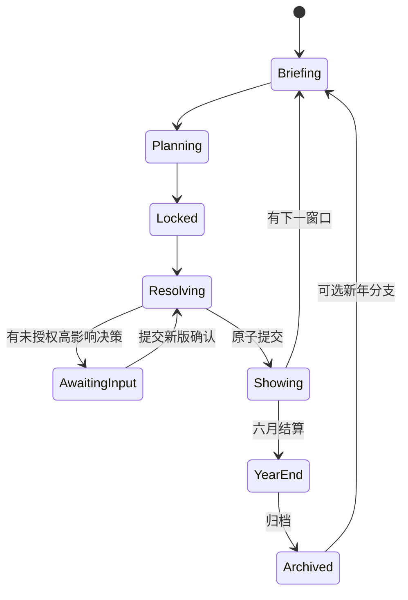

# Campus Chaos 3.0 架构 · 从五日挑战到学年世界

日期 2026-11-19。本文记录现状证据及目标协议。玩法口径以[产品 GDD](CAMPUS_CHAOS_3_PRODUCT_GDD.md)和[内容手册](CAMPUS_CHAOS_3_EVENT_BIBLE.md)为准，改动顺序见[实施计划](CAMPUS_CHAOS_3_IMPLEMENTATION_PLAN.md)。

## 1. 真实项目审计

工作区根目录包含独立的 `campus`、`jiangcheng`、`dabian`，游戏业务在 `campus`。[任务书](Campus_Chaos_3.0_Codex_学年制重构规划任务书.md)目前位于 `campus/docs`，已核对移动前后正文一致。`campus/package.json` 使用 Next.js App Router、React、TypeScript、Zod 和 Lucide，运行入口为 `npm run dev`、`npm run build`、`npm start`，测试为 Vitest 和 Playwright。`/` 重定向 `/campus-chaos`，页面读取 `seed/scenario/mode`。导演配置是服务端 `AI_API_KEY/AI_MODEL/AI_API_BASE_URL`，当前运行服务为 `127.0.0.1:3060`。年度存储层是本规划的新模块。

### 本轮复测

2026-11-19 用 Edge 运行当前生产 Demo。1366×768 全屏进入，两局用相同动作顺序「联动 → 彩排 → 宣传 → 搭建 → 协调」，事件选第一项并保留默认提案。两局均开场、无页面异常。实时局在第三天刷新，预算 ¥410 回到原位，全屏需重新进入。

| 运行 | 导演与恢复 | 最终预算／报名／容量／准备度／凝聚力 |
| --- | --- | --- |
| 固定种子 `sakura-01` | 浏览器内规则，0 个导演请求 | ¥305／45／47／97／86 |
| 实时 AI | 四个响应均为 `live_ai`，用时约 1.23、1.02、1.04、1.14 秒；依次为排班分歧、预告传播、候补压力、志愿者物料 | ¥150／46／60／95／94 |

`npm test -- --silent=false` 本轮 11 项通过，并重新覆盖 480 局模拟、11 种事件、6 种结局。仓库现有 7 个 Playwright 用例，相关旧证据见 [P1 验收](P1-验收结果.md)。本轮实际浏览器结果见上表，E2E 基线回归命令纳入下轮任务。`/api/health` 的 `live_ai` 仅表示已配置，实际响应和采用后的台账才证明真实调用。个别运行时延仅作五日对照。

### P0/P1 能力与切换边界

| P0/P1 现状 | 代码与证据 | 3.0 去向 |
| --- | --- | --- |
| **已实现** 六动作、预算、报名/接待/候补、边际收益、赞助与折扣 | [rules.ts](../src/game/rules.ts) 的 `actionDetails/actionEffect/getAttendance/getOutcome`；固定种子局可见 | 保留五日数值；把对应机制映射到学年项目、受众、权益和合同 |
| **已实现** 事件及可勾选提案、短理由、数值预览 | [events.ts](../src/game/events.ts)、[offers.ts](../src/game/offers.ts)、[director.ts](../src/server/director.ts)；AI 实选合法事件＋一次性提案，游戏验证后应用 | 复用候选＋校验＋结算习惯；年度加入自主意图、实际执行、反价、延期与履约 |
| **已实现** 雨备剧本、全屏广场、动作反馈 | [scenarios.ts](../src/game/scenarios.ts)、[Courtyard.tsx](../src/ui/Courtyard.tsx)、[styles.css](../src/app/styles.css)；三个背景和有限精灵、人数按比例显示，站位为条件投影 | 沿用美术、全屏和低动效习惯，新增场景投影与地图行动入口 |
| **部分实现** 保存、重放、去重、日志 | [save.ts](../src/game/save.ts) 重放玩家动作、原事件提案和处理选择；单本地键。客户端按会话/版本/许可候选保护，模型端进程内暂存 128 项、120 秒、并发 4。日志有资源差值和事件标签 | 已有局内命令重放可直接保留；年度需要独立档位、跨标签页持久 CAS、因果引用、快照及已采用意图 |
| **未实现** 自由策略、四维关系、角色工时、自主外社、多项目、学年与年鉴 | [model.ts](../src/game/model.ts) 的角色是三个固定岗位 ID＋心情；`Flag` 里的 `alliance`/`venue` 只作状态修饰；未找到外部实体、承诺对象或谈判入口 | 设立人物／组织／项目实体与各自权限；五日旗标继续留在旧域 |
| **与现架构冲突** 拉长回合、并行预约或多事件 | `maxTurns=5`；`takeAction` 单主行动即转 `directing`，第五天直结；`commitDirector` 只持一个 `incident` 并加一天。候选写有 `turn===4`、雨前两天、二选一。请求只容 1–4 天、版本≤15、历史最多 3 事件，存档最多 13 条；UI 固定五天、单广场、单目标 | 年度日历、命令与事件实例另建；逐步下沉纯函数，不扩大这些五日枚举和限制 |

快速挑战的 `history` 是回合日志与可重放命令的来源，尚无事件级稳定因果 ID、全量可归因事务或多年快照。`useCampusRun.ts` 管浏览器状态、保存及异步竞态，导演路由接收客户端快照后验证结构和合法候选，服务端未持有权威年度存档。`Courtyard` 从报名、已搭建次数和单一当前事件推导精灵，无法凭现字段重建人物行动路径。

## 2. 三种架构及决策

| 路线 | 实施成本 | 玩法表达 | 可测性 | 五日兼容 | AI 扩展 |
| --- | --- | --- | --- | --- | --- |
| 演进旧 `GameState` | 开头低，多项目/多人后反复迁移 | 一个事件/一次动作的假设压住长期分支 | 会在同一 reducer 累积不同规则和新旧快照用例 | 短期高，年度改动会碰到旧存档 | 易新增联动加成，难表现独立日程和谈判 |
| 一次重构统一领域核 | 开头最高，同时改五日入口及存档 | 高 | 长期高，首批验证需等页面和迁移一并就绪 | 快速挑战的台词、回合边界、数值需精确重演 | 高，首批接入较晚 |
| **混合式，选定** | 中；先并行新核，按实际复用提取模块 | 高，学年按世界实体建模 | 两套冻结基线，年度事务可单测与重放 | 最好，原动作、API 与存档路径直接保留 | 新年度协议独立迭代，旧导演仍工作 |

首批在 `/campus-chaos/year` 建立自洽垂直切片，`/campus-chaos` 仍为快速挑战，发布收口时 `/` 改为学年优先的游戏入口。P1 的候补逻辑和场景约定有实际共用时提取；年度参数带项目、时间和权属，使用单独的类型。技术栈继续用现有 Next/React/Zod/Vitest/Playwright。年度缺少可原子写多记录的持久层，新增浏览器 IndexedDB 存档与事务；默认原生接口，在持久化垂直验证中仅当原生封装难以安全复用事务时评估轻量封装。采用原生 Fullscreen、DOM 分层、CSS 移动，先用实测决定人群是否需要 Canvas。

## 3. 目标目录与权属

| 目录（拟新增） | 主权与调用方向 |
| --- | --- |
| `src/year/model.ts`、`calendar.ts`、`commands.ts`、`events.ts` | 共同的领域契约、版本、时间、命令，纯 TS，无 React/网络/浏览器依赖 |
| `src/year/engine/{reducer,turn,reservations,projects,relations,actors,diplomacy,triggers,succession}.ts` | 生成及提交事件、纯回放、授权/项目/谈判/调度/换届；引擎只能读取已注册的内容 |
| `src/year/content/{registry,chapters,scenarios,npcs,clubs,chains}.ts` | 带版本的冬春日历与内容；用 Zod 检数据。触发 DSL 只由已注册规则组合；内容无任意脚本 |
| `src/year/view/{worldProjection,yearbookFacts}.ts` | 只读投影、因果解释、年鉴事实块与演出；UI 与 AI 摘要共读事实，却不共享私密投影 |
| `src/year/storage/{idb,save,replay,migration}.ts` | 快照＋账本原子持久化、档位读写和旧档入口路由 |
| `src/server/year/{context,planner,provider,limits}.ts`、`src/app/api/campus/year/*` | 模型与调用审计；服务器接受经过边界验证的摘要，不替玩家提交世界事件 |
| `src/ui/year/{YearShell,CampusMap,ActionTray,NoticePanel,NegotiationSheet,CalendarBoard,Yearbook}.tsx` | 命令发起、地图和选择、移动底板，订阅投影；渲染和动画不得改世界状态 |
| `src/app/campus-chaos/year/*` | 年度、单章和回放入口。旧挑战源码、路由、查询串和已有美术仍可用 |

### 世界数据

以下为目标类型的稳定字段，ID 在同一 campaign 内不复用。可发出的指令见 `Command`，可播放的变化见 `WorldEvent`。引擎内部使用整数，金额为分，人时以 30 分钟为单位，比例用万分比。预算与人数不会因小数舍入出错。关系有方向，联盟另存共同章程；未知信息在界面显示出处或「尚未打听」。

```ts
type Id = string
type Tick = number // 虚构学年起点起算的半小时；区间为 [from, to)
type Revision = number
type Ref = { entityId: Id, eventIds: Id[] }
type SlotRange = { from: Tick, to: Tick }
type Phase = 'briefing' | 'planning' | 'locked' | 'resolving'
  | 'awaiting_input' | 'showing' | 'year_end' | 'archived'

type World = {
  schemaVersion: 1; rulesVersion: string; contentVersion: string;
  campaignId: Id; yearId: Id; revision: Revision; eventCursor: number;
  seed: string; phase: Phase; windowId: Id; tick: Tick; chapterId: Id;
  playerClubId: Id; presidentId: Id;
  people: Record<Id, Person>; clubs: Record<Id, Club>;
  relationships: Record<Id, DirectedTie>; alliances: Record<Id, Alliance>;
  venues: Record<Id, Venue>; assets: Record<Id, Asset>;
  reservations: Record<Id, Reservation>; grants: Record<Id, Grant>;
  projects: Record<Id, Project>; negotiations: Record<Id, Negotiation>;
  commitments: Record<Id, Commitment>; incidents: Record<Id, IncidentInstance>;
  pendingEffects: ScheduledEffect[]; planning: PlanningSession; ending?: Ending;
}
```

| 实体 | 必有字段及生命周期 |
| --- | --- |
| 日历 | `yearIndex, semester, chapterId, windowId, from, to, milestones[], quietPolicy`。ID 格式如 `Y01-I-W03`；日期换算只读内容日历，不用真实服务器时钟。回合用日期分配各场地的开闭、人时和期限。 |
| 人物 | `id, name, clubMemberships[{club,role}], yearGroup, role, traits, goalIds, proficiency, certificates, energy, satisfaction, classes, exams, outsideCommitments, workload, availabilityBySlot, status, assignmentIds, memoryRefs`。状态 `active → concerned → leave_requested → on_leave/transferred/departed`，复任/竞争设显式迁移。备考由真实时段预约体现，台账能读到原因。 |
| 社团 | `id, goalProfiles, controller, rosterIds, publicRep, operatingCapabilities, assetIds, wallet:{cash,held}, policies, projectIds, planQueue, influenceByAudience`。资金、项目和预约属于具名主体，外社的变动和玩家一样事件化。 |
| 关系／联盟 | `DirectedTie{from,to,trust[-100..100],alignment[-100..100],bond[0..100],conflictIds,sourceRefs}`。冲突条目有诉求、证据、解决阶段。`Alliance{id,members,lead,voteRule,shares,exitNoticeAt,linkedCommitments,stage}` 随合同成立、暂停参与、解约；解约不自动消除已签义务。 |
| 授权 | `Grant{id,issuer,delegate,club,verbs,projectIds,resourceIds,from,to,maxSpend,reserved,spent,revoked,sourceEvent}`。默认任何大额支出和公开长期承诺要玩家确认；临时预算限制以出资方、项目及期限核对。 |
| 项目／里程碑 | `Project{id,type,clubIds,lead,venueIds,stage,windows,workItems,milestones,financialLimit,attendancePlan,artifacts,contractIds,riskRefs}`。阶段 `proposed → scheduled → preparing → live → reviewed`，可 `suspended/replanned/cancelled`。工作项有负责人、时段、所需能力/工时和依赖。 |
| 预约与资源 | `Reservation{id,funder,ownerId,projectId,resourceId,range,units,status,commandId}`，`held/confirmed/released/expired`；`Venue` 有开放时段和容量，`Asset` 有库存、所在地点、所有者。人物可用时段的课业及个人承诺同一冲突检测。 |
| 承诺 | `Commitment{id,termsVersion,debtor,beneficiary,projectId,terms,deliverables,dueAt,guarantees,proofs,status,sourceEventId}`。`promised → active → fulfilled`，并行结局 `overdue/breached/remediating/waived`；改期/分段履约需双方同意，保存历史版本与已交付数量。 |
| 谈判与事件 | `Negotiation{id,parties,threadRev,termsByVersion,expiryTick,acceptedGroups,requiredSigners,stage,proposalOwner,reasonRefs}`。`IncidentInstance{id,definitionId,uniqueKey,triggerTick,deadline,stakeholders,causeIds,state,presentation}`。 |
| 会话与结局 | `PlanningSession{turnKey,stage,basisDigest,sealedPlanIds,pendingJobId,acceptedIntentIds,interruptId}`；`Ending{routeTags,turningPointIds,leaderResult,peopleOutcomes,carryoverSpec,publicFacts}`。可生成多相互独立的下一年分支。 |

### 策略/命令/因果协议

```ts
type Provenance =
  | { kind: 'player'; actor: Id }
  | { kind: 'rule'; ruleId: Id; fallbackCause?: 'timeout' | 'invalid' | 'unavailable' | 'skip' }
  | { kind: 'model'; traceId: Id; candidateId?: Id }
type Command<T extends Action = Action> = {
  id: Id; yearId: Id; turnKey: Id; expectedRevision: Revision; basisDigest: string;
  actorId: Id; intent?: { traceId: Id; proposalId: Id }; payload: T;
}
type Proposal = {
  id: Id; actorId: Id; goalId: Id; stateVersion: Revision; targetIds: Id[];
  action: Action; reasonEventIds: Id[]; expiresAt: Tick; confidence?: number;
}
type PlanDraft = {
  id: Id; basisRevision: Revision;
  steps: Array<{ id: Id; after: Id[]; action?: Action; missing: string[];
    atomicGroup?: Id; explanationRefs: Id[] }>;
}
type WorldEvent = {
  id: Id; seq: number; yearId: Id; turnKey: Id; tick: Tick;
  actionId: Id; actorId: Id; type: string; causeIds: Id[];
  beforeRevision: Revision; afterRevision: Revision; validatedEffects: DomainEffect[];
  preconditionDigest: string; provenance: Provenance; narrativeKey: Id;
}
```

`Action` 使用按 `kind` 区分的联合。`NEGOTIATE` 用 `counterpartyIds, project, groups, offer, request, shareBps, deadline, creditTerms`；`DELEGATE` 用 `personId, verbs, scope, cap, expiresAt`；`SCHEDULE` 用 `resourceId, projectId, headcount, range`；`TRAIN_MEMBER` 用 `trainer, learner, certificate, exerciseId, range`；`SIGN/AMEND/CANCEL_CONTRACT` 用 `negotiationId/contractId, termsVersion, groups, approvalToken`。其余 `RECRUIT, ORGANIZE_EVENT, INVEST, PROPOSE_ALLIANCE, EXCHANGE_RESOURCE, RESOLVE_CONFLICT, REASSIGN_ROLE, SET_POLICY, REST` 分别限定人物、活动、资源、场所或政策字段。`APPROVE, REJECT, LOCK_TURN, CONTINUE_LOCAL, CLOSE_TURN, VOTE, START_NEXT_YEAR` 由应用界面的玩家操作或程序时钟触发。字段与事件判别联合落在 `commands.ts/events.ts`。对不确定策略返回可编辑缺项、依赖关系和替代路径，结算不会将未解析句子当成动作。

合约协议的最短可执行形态如下。同一组的实际报价期限、日程和资金在双方确认后一起锁定。其他行动按同样的窄参数形成联合，不允许运行时写自由键。

```ts
type ResourceTerm =
  | { kind: 'cash'; fromClub: Id; toClub: Id; cents: number; at: Tick }
  | { kind: 'reservation'; owner: Id; beneficiary: Id; resourceId: Id;
      range: SlotRange; units: number }
  | { kind: 'deliverable'; debtor: Id; beneficiary: Id; workKey: Id; dueAt: Tick }
type DealGroup = {
  id: Id; requires: Id[]; offer: ResourceTerm[]; request: ResourceTerm[];
  shareBps?: Record<Id, number>; creditTerms?: { leadClub: Id; coCredits: Id[] };
}
type NegotiationAction = {
  kind: 'NEGOTIATE'; negotiationId?: Id; counterpartyIds: Id[]; project: Id;
  groups: DealGroup[]; deadline: Tick; supersedesTermsVersion?: number;
}
type IntentDecision = {
  proposal: Proposal; disposition: 'autonomous' | 'needs_approval' | 'rejected';
  permissionEvidence: Id[]; urgency: 'low' | 'medium' | 'high';
}
```

每个组的分成相加须为 10,000。签署组的依赖必须已生效或同时签署，报价中两组互相依赖时合并为单一原子组，避免循环依赖。例：音乐节 `stage` 组含音乐社排练位、我方宣传交付、`shareBps: { player: 5000, music: 5000 }` 和共同署名。`photo-inquiry` 独立草案没有费用或预约。首版播放器显式区分「拟定」「已同意」「已锁定」「已交付」。意图审批状态由校验器计算，模型不能直接给出该状态。

预览与结算调用同一个 `validateAndPlan(world, command)`。预览显示确定预约与金额、估计区间、尚需对手反馈或审批的条件；提交时重新验证同内容、修订与权限。玩家签署需看过本版条款；`approvalToken` 绑定 `planHash, expectedRevision, scope, expiresAt`，由应用确认环节生成，模型只可申请。收据顺序：先检查同 ID 已提交的负载哈希，相同负载返回原结果；ID 相同而负载不同是冲突；再检查版本和日期。失效响应可重新打开草案，任何旧模型结果不能覆盖新世界。

`DomainEffect` 记录有类型的现金转移、预约、关系变动、角色变化、项目推进、触发登记或交接。每条因果必须指向更早的已提交事实。同一事务内先给事件分配稳定序号，后序事件才可引用前序事件。现实时间仅用于审计耗时；玩法不读取它。ID 由持久化命令 ID 与序号推导，避免随机 ID 干扰重放。

## 4. 时间调度、交易与 AI

### 窗口状态机



`briefing` 登记当期锚点、处理对玩家已公开的提醒；`planning` 内可确认有效预约、签合同与授权，每次是独立事务。`LOCK_TURN` 固化当前修订及已确认战略，保存待决工作；模型阶段读取去除私密字段的计划摘要。`resolving` 在临时投影中处理批准的方案、已有合同交付、参与人物/社团的独立行动、争用与活动结果。临场事件需人工介入时只持久化中断点、待选方案及合法已采纳意图，待处理的支出或结果不先写。玩家确认新方案后用新版本校验受影响的资源，保留与其无关的合法意图，按相同结算次序继续。`CLOSE_TURN` 一次提交待决效果、事实、快照/游标和收据。`showing` 只读取事实投影，无业务增减。

结算顺序固定：已有签约预约与同轮已确认安排 → 必须履行的任务 → 可授予的自主意图 → 稀缺资源竞争 → 预约和人群计算 → 已到期义务在当日活动交付之后结算 → 关系与成长 → 触发后果与章节转场。若已有预约被雨水取消，先写地块不可用事件，再进入改场或退款。没有兼容替代时提供改期或按条款退出。算法按 `tick, 优先类别, 公开出价条件, 稳定 tieBreak` 排序。同一时间同设备/场地/人物不可超订，不可提前交付超出可用现金或工时。关系按完成、违约、照护和目标一致的事件更新。整理活动收益时先结成本负债，再按份额向各方账户分配，最小金额余数按已签规则分给牵头方。

平静日循环逐窗口处理，不能略过冲突和逾期检验。相同条件的环境事件按 `definitionId|scopeId|timeBucket` 生成实例键，因果事件用 `definitionId|originFactId|stakeholder`。触发可延迟、被改期、因条件变化取消，均留出状态和理由。复发事件必须另有真实起因或冷却已满。未响应事件按内容的 `onExpiry` 规则结算，重大不可逆项暂停向前。世界随机按种子、年份、窗口、`channel/key` 分流，环境、抢位打平和活动波动相互独立，新增插曲不扰动已录规则序列。

一周的人时按每周有效班表提供，跨两周的窗口可以分别安排；考试挤压的是具体日期和时段。人员、独占设备和租用场地按半小时区间检重；可共享资产按每个相交时段的已用单位与有效总数比较。资金的可用额是 `cash - held`，确认合同先冻结额度，交付用冻结部分扣实收实付，取消时按条款释放或补偿。活动接待值是开放场地容量、物料支持和已排班入口三者的最小值。品质初值按已验收筹备里程碑 35%、适配技能 25%、值班覆盖 20%、受众/动线设计 20% 加权；缺最后演出位等必需条件时先走改期/缩场。秩序、入场、财务分别出事实，年鉴只消费这些事实，活动品质和人气都可独立达标。

### 自主意图、谈判和导演三层

1. `actors` 给每个活跃人物和外社生成 1–3 类可做事和时段，也允许休息、学习、续做现有任务。角色目标匹配、时间余量、履约、关系与风险构成规则评分；同一输入的固定导演选法稳定。实时模式批量挑出活跃局面中最有影响的 4–6 个决策，由模型在具名对象、现有能力和授权范围内选择，或返回一条合法组合供验证。全体底层项目日程不依赖模型逐个调用。外社可提出面向另一外社的合作，使用同一场地冲突与签约规则。
2. `diplomacy` 从双方剩余工时、资产与财务推导可行方案，基于目标收益、对应费用、违约风险及替代机会计算保留条件。对方 AI 可以反价诚实可行条款、改期、接受部分独立条件或拒绝，规则检查对应接受阈值与资源。`draft → sent → countered/partial → agreed → signed`；任何新价生成独立条款修订且须重新同意，`expired/rejected/superseded` 可发重谈。签署独立组时只锁这一组，互依条款同成败。取消债务必须覆盖规则允许的退还、补偿或既有合同义务。
3. `triggers` 确定锚点与跨月因果；导演只挑当前值得呈现的合法分支，不撤销到期义务。年鉴使用事实 ID、事件排序和已渲染证据块。模型可选重点与润色小标题，不能新增可见的事实性陈述。解释界面能跳原始承诺、来源和账本。

谈判基线按每方计算 `U = 净现金效用 + 目标匹配 + 场次价值 + 署名价值 − 货物及工时成本 − 失约风险`。各项采用社团的价值权重和可解释分档。对该方最高的可执行独立方案或现有替代报价取保留值，导致冲突或强制透支的条款先退出候选。例：音乐节情境中，音乐社从五五报价得到现金效用 +2、演出目标 +4、档期价值 +3、工时成本 −4、履约风险 −1，合计 4。与摄影社的替代方案值 5，于是当场提出共同署名使己方增益 +3、总值 7，或另报小场。对手的下一步由模型从可解释方案中选择，也能调整合法比例和工时；是否可接受仍重算两边预算、排期、分成与同意。数字作为首批调参的夹具，不对玩家显示对方私有保留值。

权限跟随共用角色与实体权限引擎。继续已排工作、学习、免费询价、发非正式草案和已有授权范围内的小额执行可以自主发生。新长期合同、对玩家控制的账户作超授权支出、重大项目取消或出售、职位剥夺、正式退会等分别走拥有者同意、玩家确认或角色同意；角色自由离职需要通知和条件交接，并不要求玩家批准角色本人去留。接受但有保留时记录责任异议和目标冲突，不能偷扣没有证据支持的关系值。

### API、速率与模式

| 边界（拟） | 输入输出与恢复 |
| --- | --- |
| `POST /api/campus/year/plan` | 玩家短文本、当前选择的地点/项目、允许实体范围、日期及已知事实，连同 `yearId/turnKey/expectedRevision/requestId/contextDigest`。返回 `PlanDraft` 与 `trace`；异常用结构化表单继续。确认前不执行。 |
| `POST /api/campus/year/decide` | `kind: 'turn' / 'reply' / 'yearbook'`，提交可用候选与简洁证据摘要；返回 `proposals/eventChoices/actorFocus/trace` 或只读叙事排序。服务器交叉校验允许的 ID、约束外字段、请求体和组合；客户端重验真实状态。 |
| `GET /api/health` | 保持现五日健康端点，新增年度可用路径或在年度路由里独立探测配置。配置检测与模型调用成功分别显示。 |
| 本地写命令与读世界 | 无远端写世界 API。`commit(expectedRevision, command)` → `Receipt{status,events,rejectCode}`，`loadSlot/replayRange` 查 IndexedDB。并发从收据和版本竞争中获得明确结果。 |

年度服务端 Provider 复用当前 OpenAI 兼容协议的连接经验。当前 MaaS 的短输出经 `reasoning_effort: 'none'` 验证；多角色 JSON 输出长度和尾延迟在首批垂直实验测，避免直接沿用五日 `max_tokens:110`。日常 ≤1 批调用，紧急或玩家主动谈判分阶段请求，按需并行取无写入草案；申请/每方反报价通常最多 2 次来回，之后玩家仍可改条款或重开线程。预算与上限按本地与公开部署的访问需求分别配置。服务器设置全局和每来源速率、最大体积、并发与超时，公共演示部署前做入口访问控制或配额。收集用途、模型/模板/协议/内容版本、结构输入哈希、返回哈希、耗时、可提供的 token、采纳和拒绝原因。原始自然语言默认仅用于本次调用且不持久化，首次自由输入明确数据发送范围并可用手工等价表单。密钥仅服务端，外部文本仅作语料解析。

**实时**为正式体验；**重放**只读记录原始采纳来源加重放标签，禁止发模型请求；**固定演示**同规则同种子；**降级**记录故障缘由和采用的规则，后续可恢复真实。待请求到时界面可先查看其他非提交内容，选择立即本地处理。尝试旧请求时以当前调度尝试的 ID 与版本双重核对。

## 5. 存档、兼容与运营边界

IndexedDB 记录 `slots`、`events[yearId+seq]`、`receipts[yearId+commandId]`、`snapshots[yearId+revision]`、`pendingJobs`。准备事件集合和校验哈希在事务前完成；单次读写事务内重读当前 `revision/headDigest`，比较成功才写事件、收据、新快照游标及头部。写盘失败保留旧提交，界面保留草案并显示重试/导出；不静默宣称保存。第二标签页拿到冲突码后刷新头部，草案可重新预览；广播通知只辅助提示，CAS 才决定谁成功。生成事件中途退出则恢复最新锁定步骤，已接受模型意图继续结算，未收到时重试同一待决请求或明确规则接管，拒绝迟到结果。

初始、章末、年度及每 8 个事务留快照，恢复最近可验证快照和后缀。快照、日志、规则版本、内容哈希和已采纳意图可导出，导入先校验大小、有序 ID、因果、版本与状态哈希。规则与内容版本钉住；旧版由受支持的版本重放，若明确迁移则另建档位并对照摘要，原档保留为回滚，再旧版本可只读事实并导出。主数据哈希排除墙钟及文案呈现字段，年鉴事实另校验。

五日 `localStorage['campus-chaos-p1']`、`version:1`、旧路由参数和服务端响应契约原样读取；不把五天数据冒充完整九月档。年度独立键与档位，第一次进入可看见「继续五日挑战」。P1 局允许继续到结局，年度人物开局有明确新初始预算。没有记录的数据不追造老承诺。迁移测试分别喂老的已完成、进行中、等待、坏档。新学年创建新 `yearId`，向旧年收尾事件建立跨年只读引用，继任身份、资产、尚在期限内的义务与关系依据审定的交接方案载入，每跨年不覆写旧档。

## 6. 场景投影与校验

`worldProjection` 按地块输出场景资源、公开预约、当前活动、人群规模分桶、人物当前位置、目标位置及说话来源。移动动画读已提交的 `ActorMoved` 或从日程投影读计划虚线，交易中的暂定位置有明确标识。合同/活动归档时可回到该窗口快照。可见范围内绘制具名精灵和有限人流，离屏区域只更新状态，地图选择、视角及减少动画是独立的 UI 状态。普通布局与全屏同一投影与命令。演出即使跳帧也以最后一份已提交状态收敛。

实施时首个可推翻设计的实验是：从既有入口保留五日档，学年新入口执行九月摊位争用、十月合约、十一月落地，然后在相同世界继续到六月。若单项目 load/cost 未达标，先缩减热读内容与重播长度；若自由语句解析受网关限制，保留分步模型与编辑器，不降级正式内容。具体闸门见[实施计划](CAMPUS_CHAOS_3_IMPLEMENTATION_PLAN.md)和[验收](CAMPUS_CHAOS_3_ACCEPTANCE.md)。
